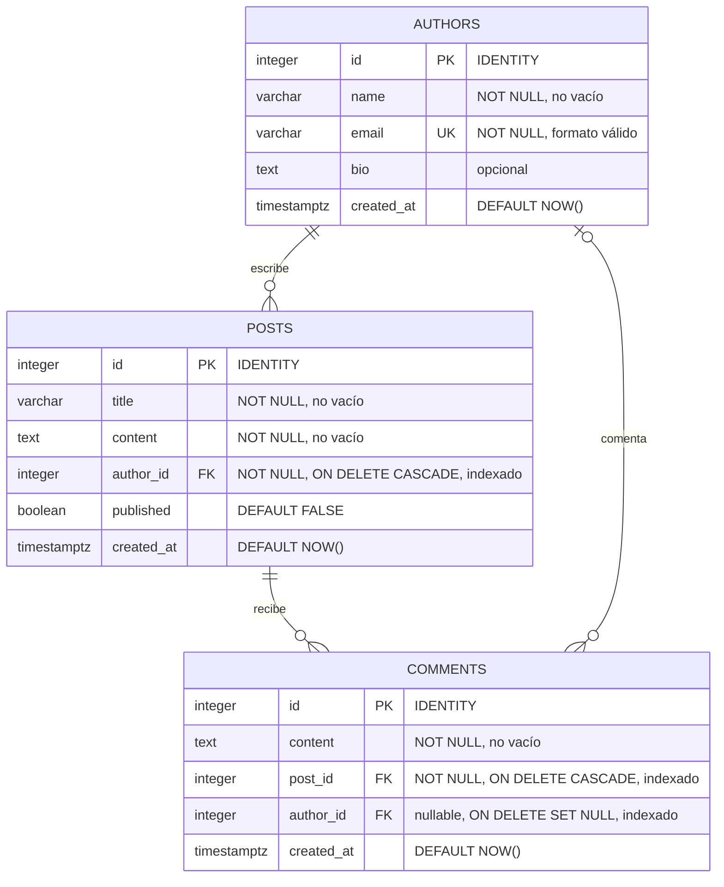

# API MiniBlog para DevSpark

API REST para gestionar **authors**, **posts** y **comments** de MiniBlog, el servicio de contenidos de DevSpark. Está construida con **Node.js + Express** y usa **PostgreSQL** para guardar los datos.

Es el Proyecto Integrador del Módulo 2 del bootcamp Full Stack de Henry.

- **API en producción:** https://proyectom2frederick-production.up.railway.app
- **Comprobación de estado:** https://proyectom2frederick-production.up.railway.app/health
- **Documentación OpenAPI:** [`docs/openapi.yaml`](./docs/openapi.yaml)

---

## Contenido

1. [Tecnologías](#tecnologías)
2. [Estructura del proyecto](#estructura-del-proyecto)
3. [Modelo de datos](#modelo-de-datos)
4. [Endpoints](#endpoints)
5. [Validaciones y manejo de errores](#validaciones-y-manejo-de-errores)
6. [Ejecutar el proyecto en local](#ejecutar-el-proyecto-en-local)
7. [Tests](#tests)
8. [Documentación OpenAPI](#documentación-openapi)
9. [Deploy en Railway](#deploy-en-railway)
10. [Decisiones de diseño](#decisiones-de-diseño)
11. [Registro del uso de IA](#registro-del-uso-de-ia)

---

## Tecnologías

| Herramienta | Uso |
|---|---|
| Node.js (22 o superior) | Entorno de ejecución |
| Express 5 | Servidor y rutas |
| PostgreSQL | Base de datos |
| pg | Conexión a PostgreSQL con consultas SQL parametrizadas |
| Vitest + Supertest | Tests automatizados de la API |
| Railway | Deploy de la API y de la base de datos |

El proyecto usa **CommonJS** (`require` / `module.exports`). Las variables de entorno se cargan con `loadEnvFile` de `node:process`, sin dependencias externas.

---

## Estructura del proyecto

```
ProyectoM2_Frederick/
├── docs/
│   └── openapi.yaml            # Especificación OpenAPI 3.0 de la API
├── sql/
│   ├── setup.sql               # Crea las tablas, constraints e índices
│   └── seed.sql                # Carga los datos de ejemplo
├── src/
│   ├── db/
│   │   └── pool.js             # Conexión a PostgreSQL (Pool de pg)
│   ├── middlewares/
│   │   ├── validators.js       # Validación de parámetros y body
│   │   └── errorHandler.js     # 404 de rutas inexistentes y manejo global de errores
│   ├── routes/                 # Endpoints: reciben la petición y responden
│   │   ├── authors.routes.js
│   │   ├── posts.routes.js
│   │   └── comments.routes.js
│   ├── services/               # Lógica de datos: consultas SQL
│   │   ├── authors.service.js
│   │   ├── posts.service.js
│   │   └── comments.service.js
│   ├── app.js                  # Configura Express y exporta la app (sin listen)
│   └── server.js               # Carga el entorno, comprueba la base y levanta el servidor
├── tests/
│   └── api.test.js             # 21 tests con Vitest + Supertest
├── .env.example
└── package.json
```

**Por qué `app.js` y `server.js` están separados:** los tests importan `app` y le envían peticiones con Supertest sin abrir un puerto. `server.js` es el único que hace `listen`, y es el que ejecutan `npm start` y Railway.

**Por qué routes y services están separados:** las rutas solo se ocupan de HTTP (parámetros, códigos de estado y respuestas), y los services se ocupan de los datos. Durante el desarrollo, los services trabajaron primero con arrays en memoria y después se cambiaron a consultas SQL sin modificar las rutas.

---

## Modelo de datos

Un author puede tener muchos posts, y un post puede tener muchos comments. Cada comment pertenece a un post y lo escribe un author.



### Constraints e índices

| Tabla | Constraint / índice | Regla |
|---|---|---|
| authors | `authors_email_key` | El email es único |
| authors | `name_not_empty` | `name` no puede estar vacío ni ser solo espacios |
| authors | `email_format` | El email debe tener un formato válido |
| posts | `title_not_empty`, `content_not_empty` | `title` y `content` no pueden estar vacíos |
| posts | FK `author_id` → `authors(id)` | `ON DELETE CASCADE` |
| posts | `idx_posts_author_id` | Acelera `GET /posts/author/:authorId` y la cascada |
| comments | `comment_content_not_empty` | `content` no puede estar vacío |
| comments | FK `post_id` → `posts(id)` | `ON DELETE CASCADE` |
| comments | FK `author_id` → `authors(id)` | `ON DELETE SET NULL` |
| comments | `idx_comments_post_id`, `idx_comments_author_id` | Aceleran el listado por post y el `SET NULL` |

---

## Endpoints

URL base en local: `http://localhost:3000`. URL base en producción: `https://proyectom2frederick-production.up.railway.app`.

### General

| Método | Ruta | Descripción | Respuestas |
|---|---|---|---|
| GET | `/` | Información de la API y lista de endpoints | 200 |
| GET | `/health` | Comprueba que la API está funcionando | 200 |

### Authors

| Método | Ruta | Descripción | Respuestas |
|---|---|---|---|
| GET | `/authors` | Lista todos los authors | 200 |
| GET | `/authors/:id` | Detalle de un author | 200, 400, 404 |
| POST | `/authors` | Crea un author | 201, 400 |
| PUT | `/authors/:id` | Actualiza un author (reemplaza todos sus campos) | 200, 400, 404 |
| DELETE | `/authors/:id` | Elimina un author y sus posts | 204, 400, 404 |

### Posts

| Método | Ruta | Descripción | Respuestas |
|---|---|---|---|
| GET | `/posts` | Lista todos los posts | 200 |
| GET | `/posts/:id` | Detalle de un post | 200, 400, 404 |
| GET | `/posts/author/:authorId` | Posts de un author con su `author_name` y `author_email` | 200, 400, 404 |
| POST | `/posts` | Crea un post | 201, 400 |
| PUT | `/posts/:id` | Actualiza un post (reemplaza todos sus campos) | 200, 400, 404 |
| DELETE | `/posts/:id` | Elimina un post y sus comments | 204, 400, 404 |

`GET /posts/author/:authorId` responde **200 con una lista vacía** si el author existe pero no tiene posts, y **404** si el author no existe.

### Comments (extra credit)

| Método | Ruta | Descripción | Respuestas |
|---|---|---|---|
| GET | `/comments` | Lista todos los comments con el nombre de su author | 200 |
| GET | `/comments/post/:postId` | Comments de un post | 200, 400, 404 |
| POST | `/comments` | Crea un comment en un post | 201, 400 |

### Ejemplos de body

**POST / PUT `/authors`**
```json
{
  "name": "Laura Méndez",
  "email": "laura@example.com",
  "bio": "Diseñadora UX"
}
```

**POST / PUT `/posts`** (si no se envía `published`, el post se crea como borrador)
```json
{
  "title": "Índices en PostgreSQL",
  "content": "Un índice acelera las búsquedas por una columna...",
  "author_id": 2,
  "published": false
}
```

**POST `/comments`**
```json
{
  "content": "Excelente explicación de REST",
  "post_id": 3,
  "author_id": 2
}
```

---

## Validaciones y manejo de errores

La API valida en dos capas:

1. **Validaciones en Express** (`src/middlewares/validators.js`). Revisan los datos **antes** de consultar la base y responden **400** con todos los errores encontrados.
   - `name` y `email` obligatorios en authors; el email debe tener un formato válido.
   - `title`, `content` y `author_id` obligatorios en posts; `published` debe ser booleano si se envía.
   - `content`, `post_id` y `author_id` obligatorios en comments.
   - Los parámetros `:id`, `:authorId` y `:postId` deben ser enteros positivos.
2. **Middleware global de errores** (`src/middlewares/errorHandler.js`). Traduce a respuestas HTTP los errores que solo la base puede detectar:

| Código de PostgreSQL | Caso | Respuesta |
|---|---|---|
| `23505` unique_violation | Email repetido | 400 "Ya existe un author con ese email" |
| `23503` foreign_key_violation | `author_id` o `post_id` que no existe | 400 "El registro relacionado no existe" |
| `23514` check_violation | Dato que no cumple un `CHECK` | 400 |
| JSON mal formado | Body que no es JSON válido | 400 |
| Ruta inexistente | Cualquier URL no definida | 404 |
| Cualquier otro error | Fallo interno | 500 "Error interno del servidor" (el detalle solo se registra en consola) |

**Formato de los errores:**
```json
{
  "error": "Datos inválidos",
  "details": ["name es obligatorio y no puede estar vacío"]
}
```

Todas las consultas SQL usan parámetros (`$1`, `$2`...). Los datos del usuario nunca se concatenan en el texto de la consulta, lo que evita la inyección SQL.

---

## Ejecutar el proyecto en local

### Requisitos

- Node.js 22 o superior
- PostgreSQL instalado (`psql` disponible en la terminal)
- Git

### 1. Clonar e instalar dependencias

```bash
git clone https://github.com/The-killing-joke/ProyectoM2_Frederick.git
cd ProyectoM2_Frederick
npm install
```

### 2. Crear el usuario y la base de datos

Conéctate como superusuario (`psql -U postgres`) y ejecuta:

```sql
CREATE USER mini_blog_user WITH PASSWORD 'tu_contraseña';
CREATE DATABASE mini_blog OWNER mini_blog_user;
```

El usuario debe ser **dueño** de la base. Desde PostgreSQL 15, un usuario que no es dueño no puede crear tablas en el esquema `public`, aunque tenga `GRANT ALL` sobre la base.

### 3. Configurar las variables de entorno

Copia `.env.example` como `.env` y completa tus valores:

```dotenv
DB_HOST=localhost
DB_PORT=5432
DB_NAME=mini_blog
DB_USER=mini_blog_user
DB_PASSWORD=tu_contraseña
PORT=3000
```

| Variable | Descripción |
|---|---|
| `DB_HOST` | Host de PostgreSQL |
| `DB_PORT` | Puerto de PostgreSQL (por defecto 5432) |
| `DB_NAME` | Nombre de la base de datos |
| `DB_USER` | Usuario de la base de datos |
| `DB_PASSWORD` | Contraseña del usuario |
| `PORT` | Puerto del servidor Express (por defecto 3000) |

El archivo `.env` está en `.gitignore` y **nunca se sube al repositorio**.

### 4. Crear las tablas y cargar los datos

```bash
psql -U mini_blog_user -d mini_blog -v ON_ERROR_STOP=1 -f sql/setup.sql
psql -U mini_blog_user -d mini_blog -v ON_ERROR_STOP=1 -f sql/seed.sql
```

- `setup.sql` borra y vuelve a crear las tablas, así que se puede ejecutar varias veces.
- `seed.sql` vacía las tablas, reinicia los ids y carga 3 authors, 5 posts y 4 comments.
- `-v ON_ERROR_STOP=1` hace que `psql` se detenga en el primer error. Sin esta opción, `psql` sigue ejecutando el resto del archivo y un error puede pasar desapercibido.

### 5. Levantar el servidor

```bash
npm run dev     # desarrollo: se reinicia solo al guardar cambios (node --watch)
npm start       # producción
```

Si todo está bien, la terminal muestra:

```
Conectado a PostgreSQL
Servidor escuchando en http://localhost:3000
```

Si la base no responde, el servidor se detiene con el mensaje `No se pudo conectar a PostgreSQL` y el motivo.

### Problemas frecuentes

| Problema | Causa y solución |
|---|---|
| `password authentication failed` | Revisa `DB_USER` y `DB_PASSWORD` en `.env` |
| `permission denied for schema public` | El usuario no es dueño de la base: `ALTER DATABASE mini_blog OWNER TO mini_blog_user;` |
| Tildes que se ven mal en `psql` (Windows) | Es la página de códigos de la consola, no los datos. Ejecuta `chcp 1252` (en Git Bash, `chcp.com 1252`) antes de entrar a `psql` |
| `EADDRINUSE` | El puerto ya está en uso: hay otro servidor corriendo |

---

## Tests

```bash
npm test
```

El archivo `tests/api.test.js` contiene **21 tests** de la API, hechos con Vitest y Supertest:

| Grupo | Qué se prueba |
|---|---|
| General | `GET /` y `GET /health` |
| Authors | Listado, detalle, 404 si no existe, 400 si el id no es numérico, creación (201), 400 si falta `name`, 400 por email duplicado, actualización (200), 404 al eliminar uno inexistente |
| Posts | Posts de un author con sus datos, 404 si el author no existe, creación como borrador por defecto, 400 si el `author_id` no existe, eliminación (204 y después 404) |
| Comments | Listado por post, creación (201), 400 con los 3 errores si el body está vacío, `SET NULL` al eliminar un author y `CASCADE` al eliminar un post |

**Importante:** antes de ejecutarse, los tests corren `setup.sql` y `seed.sql` sobre la base configurada en `.env`, para partir siempre de los mismos datos. **Esto borra los datos que haya en esa base.**

Técnicamente son tests de integración: prueban la API completa contra una base de datos real.

---

## Documentación OpenAPI

La especificación está en [`docs/openapi.yaml`](./docs/openapi.yaml) (OpenAPI 3.0.3). Describe todos los endpoints, los parámetros, los bodies de entrada, los esquemas de respuesta y los códigos de error.

**Para verla:**
1. Abre [editor.swagger.io](https://editor.swagger.io).
2. Pega el contenido de `docs/openapi.yaml`.
3. A la derecha aparece la documentación interactiva, agrupada por Health, Authors, Posts y Comments.

El archivo incluye dos servidores: el local (`http://localhost:3000`) y el de producción en Railway.

---

## Deploy en Railway

La API y la base de datos están desplegadas en **Railway**, en dos servicios dentro del mismo proyecto.

### Pasos

1. **Crear el proyecto:** en Railway, *New Project* → *Deploy from GitHub repo* → seleccionar este repositorio. Railway detecta el proyecto Node, instala las dependencias y lo arranca con `npm start`.
2. **Agregar la base:** *+ New* → *Database* → *PostgreSQL*.
3. **Configurar las variables** en el servicio de la API, usando referencias a las variables del servicio Postgres:

   | Variable | Valor |
   |---|---|
   | `DB_HOST` | `${{Postgres.PGHOST}}` |
   | `DB_PORT` | `${{Postgres.PGPORT}}` |
   | `DB_NAME` | `${{Postgres.PGDATABASE}}` |
   | `DB_USER` | `${{Postgres.PGUSER}}` |
   | `DB_PASSWORD` | `${{Postgres.PGPASSWORD}}` |

   Con las referencias no hace falta copiar credenciales a mano, y si Railway las cambia, se actualizan solas. `PORT` no se define: Railway lo asigna automáticamente y el servidor lo lee de `process.env.PORT`.
4. **Generar la URL pública:** en el servicio de la API, *Settings* → *Networking* → *Generate Domain*.
5. **Crear las tablas en producción:** en el servicio Postgres, pestaña *Console*:
   ```bash
   psql -U $PGUSER -d $PGDATABASE
   ```
   ```sql
   \set ON_ERROR_STOP on
   ```
   Después se pega el contenido de `sql/setup.sql` y luego el de `sql/seed.sql`.

### URL interna y URL pública

| | URL | Para qué se usa |
|---|---|---|
| **Interna (base de datos)** | `postgres.railway.internal:5432` | La API se conecta a PostgreSQL por la red privada de Railway. Solo es accesible dentro del proyecto |
| **Pública (API)** | https://proyectom2frederick-production.up.railway.app | Acceso a la API desde internet |

La base de datos **no está expuesta públicamente**. Los scripts SQL se ejecutaron desde la Console de Railway, dentro de la red privada, para no tener que activar el acceso público a la base.

### Cómo se cargan las variables en producción

En local, `server.js` carga el archivo `.env` con `loadEnvFile`. En Railway ese archivo no existe, porque las variables las inyecta la plataforma. Por eso la carga está dentro de un `try/catch`: si el archivo no existe (error `ENOENT`), la app continúa con las variables del entorno.

### Deploy continuo

Cada `git push` a la rama `main` vuelve a desplegar la API automáticamente. Antes de cada push conviene confirmar que `npm test` pasa.

### Evidencia del deploy

<!-- Agrega aquí las capturas del deploy en estado Active y de /health respondiendo en producción. Ejemplo:


-->

---

## Decisiones de diseño

| Decisión | Motivo |
|---|---|
| `ON DELETE CASCADE` en `posts.author_id` | Un post pertenece a su author y no tiene sentido sin él |
| `ON DELETE CASCADE` en `comments.post_id` | Un comment responde a un post concreto; sin el post queda sin contexto |
| `ON DELETE SET NULL` en `comments.author_id` | El comment forma parte de la conversación de un post ajeno; borrarlo dejaría huecos, así que se conserva como de un "usuario eliminado" |
| `published DEFAULT FALSE` | Un post nuevo queda como borrador hasta que se publique de forma explícita |
| `GENERATED ALWAYS AS IDENTITY` en lugar de `SERIAL` | Es la forma recomendada actualmente en PostgreSQL para ids autogenerados |
| `TIMESTAMPTZ` en `created_at` | Guarda el momento exacto sin ambigüedad de zona horaria entre el entorno local (UTC-5) y Railway (UTC) |
| Índices en las claves foráneas | PostgreSQL no los crea automáticamente; aceleran los listados por author y por post, y las eliminaciones en cascada |
| Validar en Express y también con `CHECK` en la base | Express responde 400 con mensajes claros; la base protege los datos aunque alguien inserte sin pasar por la API |
| 400 y no 404 cuando `author_id` o `post_id` del body no existen | El dato incorrecto viene en el body, no en la URL que se pidió |
| `GET /posts/author/:authorId` y `GET /comments/post/:postId` responden 404 si el recurso padre no existe | Distingue "no tiene elementos" (200 con `[]`) de "no existe" (404) |

---

## Registro del uso de IA

Durante el proyecto usé IA (Claude) como **tutor y revisor técnico**, no como sustituto de mi trabajo. Al inicio del módulo acordé que no desarrollara el proyecto por mí: me guiaba con preguntas, pistas y revisión de mis intentos.

En el diseño de la base de datos tomé yo las decisiones (constraints, `CASCADE`, índices, valor por defecto de `published`), y la IA revisaba mi razonamiento y corregía mis errores de concepto. También escribí y probé por mi cuenta los scripts SQL y las consultas manuales (`JOIN`, errores de constraints, cascada).

En la etapa final, por el tiempo disponible, pedí que me entregara el código por partes con comentarios explicativos. Mi trabajo fue integrarlo, probarlo en Postman y con los tests, depurar los errores que aparecieron (rutas de `require`, orden de middlewares, orden de los `DROP`, variables y URL interna o pública en Railway) y preguntar cada concepto que no entendía.

El registro completo, con los prompts, las respuestas, mis comentarios y capturas de las conversaciones, está en [`docs/REGISTRO_USO_IA.md`](./docs/REGISTRO_USO_IA.md).

---

## Autor

**Frederick Bermúdez**: Proyecto Integrador M2, Full Stack Bootcamp (Henry).
